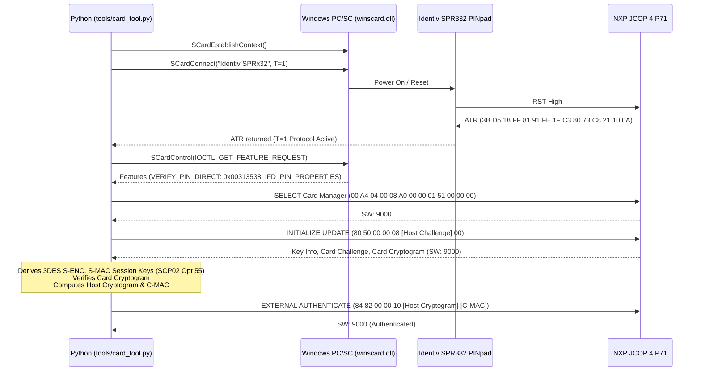
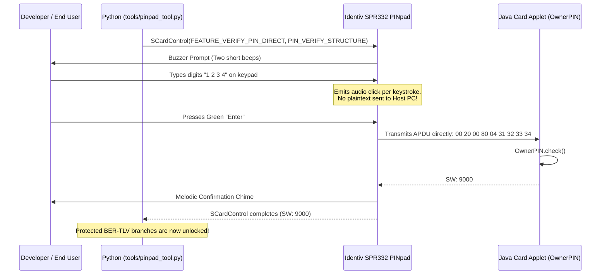

# End-to-End System Architecture: Identiv SPR332 & NXP JCOP 4 P71

**Platform**: Windows 10/11 x64 PC/SC Subsystem  
**Reader**: Identiv SPR332 (SPRx32) Class 2 USB PINpad  
**Card**: NXP SmartMX3 P71D321 running JCOP 4 OS (Java Card 3.0.5 Classic)  

---

## 1. Five-Layer Architecture Overview

```
+---------------------------------------------------------------------------------------+
| LAYER 5: APPLICATION LAYER (Host Tools & Card Applets)                                |
|   - Host: tools/card_tool.py, tools/tlv_tool.py, tools/pinpad_tool.py                 |
|   - Card: org.speckit.javacard.berstorage.BerStorageApplet                            |
+---------------------------------------------------------------------------------------+
                                           |
                                           v
+---------------------------------------------------------------------------------------+
| LAYER 4: APDU & SECURITY PROTOCOL LAYER                                               |
|   - ISO/IEC 7816-4 APDU Framing (CLA, INS, P1, P2, Lc, Data, Le, SW1/SW2)             |
|   - GlobalPlatform 2.3 Secure Channel Protocol (SCP02 Option 55, 3DES Session Keys)   |
|   - PC/SC Part 10 Control Structures (PIN_VERIFY_STRUCTURE)                           |
+---------------------------------------------------------------------------------------+
                                           |
                                           v
+---------------------------------------------------------------------------------------+
| LAYER 3: PC/SC SUBSYSTEM & CCID DRIVER LAYER                                          |
|   - Windows Native WinSCard (winscard.dll -> Smart Card Service SCardSvr)             |
|   - Microsoft Inbox USB CCID Class Driver (usbccid.sys)                               |
+---------------------------------------------------------------------------------------+
                                           |
                                           v
+---------------------------------------------------------------------------------------+
| LAYER 2: READER HARDWARE LAYER (Identiv SPR332)                                       |
|   - Microcontroller & USB 2.0 CCID Controller                                         |
|   - Class 2 PINpad Keypad Matrix (16 keys) & Acoustic Buzzer                          |
|   - ISO/IEC 7816-3 Smart Card Interface (VCC, GND, CLK, RST, I/O)                     |
+---------------------------------------------------------------------------------------+
                                           |
                                           v
+---------------------------------------------------------------------------------------+
| LAYER 1: SMART CARD SILICON & OS LAYER (NXP P71D321)                                  |
|   - Secure Microcontroller: NXP SmartMX3 P71D321                                      |
|   - Cryptographic Accelerators: 3DES, AES, RSA, ECC, TRNG                             |
|   - Storage Budget: ~140 KB Flash NVM, 3,264 bytes Transient RAM                      |
|   - Card OS: NXP JCOP 4 (Java Card 3.0.5 Classic VM & GlobalPlatform 2.3 ISD)         |
+---------------------------------------------------------------------------------------+
```

---

## 2. Sequence Diagrams

### 2.1 Hardware Discovery & SCP02 Authentication Flow



---

### 2.2 Class 2 PINpad Verification Flow


