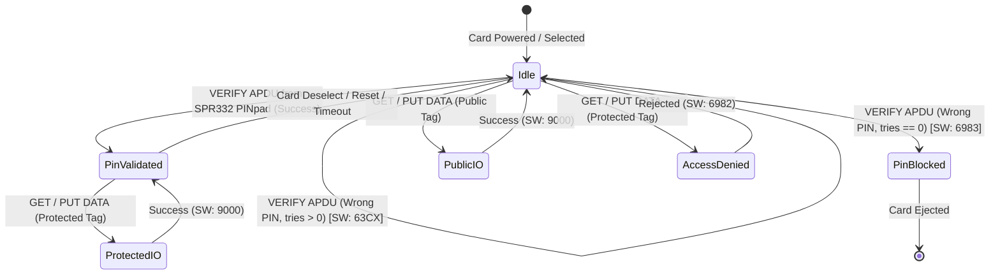

# Data Model: Java Card Hierarchical BER-TLV & PINpad Access Control

**Feature Branch**: `001-smartcard-reader-exploration`  
**Date**: 2026-09-28  
**Status**: Complete  

---

## 1. Storage Architecture & In-Memory Layout

To satisfy Constitution Principle II (Zero-Allocation in `process()`), the smart card applet maintains a pre-allocated byte buffer in persistent NVM and a transient scratchpad in RAM.

```
+--------------------------------------------------------------------------------+
|                        Persistent Flash Storage (NVM)                         |
| +-------------------------+--------------------------------------------------+ |
| | Storage Header (4 bytes)| Hierarchical BER-TLV Payload (up to 32,767 bytes)| |
| | - Magic: 0x54 0x4C 0x56 | - Tag (1-2 bytes)                                | |
| | - Version: 0x01         | - Length (1-3 bytes)                             | |
| |                         | - Value (primitive bytes OR nested TLVs)         | |
| +-------------------------+--------------------------------------------------+ |
+--------------------------------------------------------------------------------+

+--------------------------------------------------------------------------------+
|                       Transient Working Memory (RAM < 3.2 KB)                  |
| +------------------------------------+---------------------------------------+ |
| | Scratchpad Buffer (256 bytes)      | Path Traversal Index (16 bytes)       | |
| | - APDU parsing & intermediate hash | - Current nesting depth (max 8)       | |
| | - CLEAR_ON_DESELECT                | - Offset stack for iterative descent  | |
| +------------------------------------+---------------------------------------+ |
+--------------------------------------------------------------------------------+
```

---

## 2. Key Entities

### Entity 1: `StorageHeader`
- **Location**: Bytes 0..3 of the persistent storage buffer.
- **Fields**:
  - `magic` (2 bytes): `0x54 0x4C` (`"TL"`).
  - `version` (1 byte): `0x01`.
  - `flags` (1 byte): Reserved (`0x00`).
- **Validation**: If `magic` does not match on applet select/init, storage is reformatted to an empty root constructed tag.

---

### Entity 2: `BerTlvNode` (Logical Representation)
An ISO/IEC 7816-4 BER-TLV encoded node embedded directly within the storage array without heap object wrapping.

- **Tag Encoding** (1 or 2 bytes):
  - **1-byte tag**: If `(byte0 & 0x1F) != 0x1F`.
    - Bit 8..7: Class (`00` = Universal, `01` = Application, `10` = Context-specific, `11` = Private).
    - Bit 6: Form (`0` = Primitive / Leaf Value, `1` = Constructed / Container Object).
    - Bit 5..1: Tag number (`00000` to `11110`).
  - **2-byte tag**: If `(byte0 & 0x1F) == 0x1F`, followed by byte 1 with bit 8 = `0`.
- **Length Encoding** (1, 2, or 3 bytes):
  - **Definite short form**: `0x00` to `0x7F` (1 byte, length 0..127).
  - **Definite long form (2-byte)**: `0x81 [LEN]` (length 128..255).
  - **Definite long form (3-byte)**: `0x82 [MSB] [LSB]` (length 256..65535).
- **Value**:
  - If **Primitive**: Raw byte payload (text string, integer, binary key).
  - If **Constructed**: Contiguous sequence of child `BerTlvNode` elements.

---

### Entity 3: `AccessRule` (Tag Security Mapping)
Defines whether a node is publicly accessible or requires PINpad authentication.

- **Rule Policy**:
  - **Public Node**: Tag Class is Context-Specific or Private with bit 5 = `0` (e.g., Tags `0xDF01 - 0xDF7F` or `0x7F01 - 0x7F7F`).
    - Read: Unauthenticated.
    - Write: Unauthenticated.
  - **Protected Node**: Tag Class is Context-Specific or Private with bit 5 = `1` (e.g., Tags `0xEF01 - 0xEFFF` or `0xBF01 - 0xBFFF`).
    - Read: Requires active PIN verification (`OwnerPIN.isValidated() == true`).
    - Write: Requires active PIN verification (`OwnerPIN.isValidated() == true`).
    - Failure response: `SW: 6982` (Security status not satisfied).

---

### Entity 4: `OwnerPIN` Credential
The on-card PIN state object provided by `javacard.framework.OwnerPIN`.

- **Fields**:
  - `tryLimit` (byte): Maximum failed verification attempts (default: 3).
  - `maxPinSize` (byte): Maximum PIN length (8 bytes).
  - `defaultPin`: `1234` (ASCII `0x31 0x32 0x33 0x34`).
- **State Lifecycle**:
  - `TRIES_REMAINING`: Decremented on failed verification.
  - `VALIDATED`: Set to `true` upon matching PIN presentation via PC/SC Part 10 PINpad command.
  - `BLOCKED`: If tries reach 0. Returns `SW: 6983` (Authentication method blocked).
  - `RESET`: Verification state is strictly reset to `false` on card deselect or power loss (`CLEAR_ON_RESET`).

---

## 3. State Machine & Transitions


