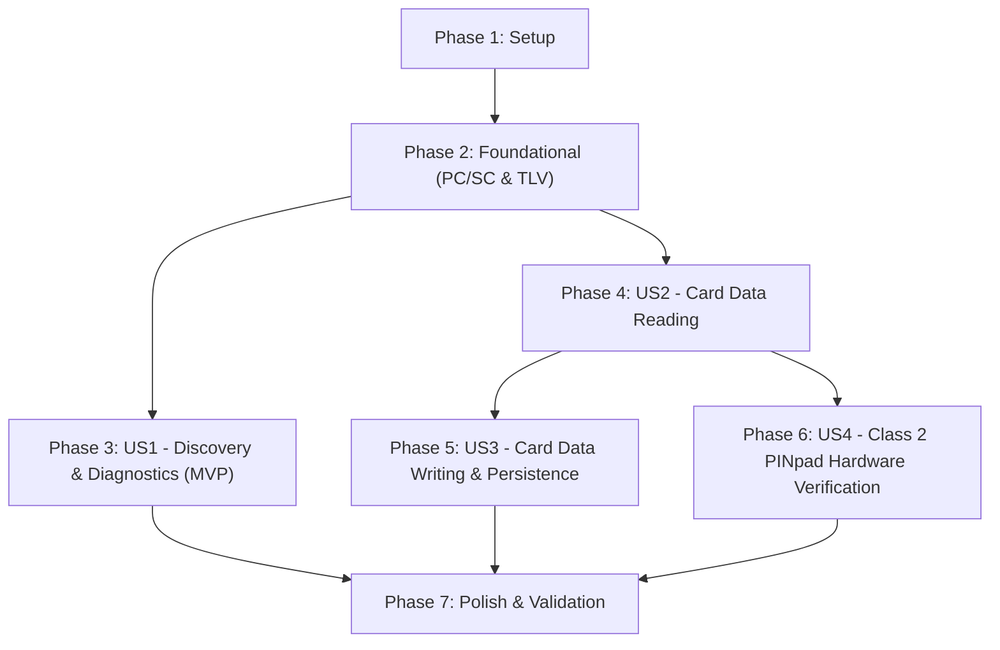

# Tasks: Smart Card & Reader Architecture Exploration and Data I/O

**Branch**: `001-smartcard-reader-exploration` | **Date**: 2026-09-28 | **Spec**: [spec.md](spec.md) | **Plan**: [plan.md](plan.md)

---

## Phase 1: Setup (Shared Infrastructure)

**Purpose**: Project initialization, directory structure creation, and shared build/test scaffolding.

- [x] T001 Create project directories for Java Card source code, host tools, test suites, and documentation per plan (`applet/src/org/speckit/javacard/berstorage/`, `tools/`, `tests/`, `docs/`)
- [x] T002 [P] Configure Python host tool environment dependencies and requirements in `requirements.txt` (`cryptography>=41.0.0`, `pyyaml>=6.0`)
- [x] T003 [P] Setup offline unit test runner script in `tests/run_tests.py`

---

## Phase 2: Foundational (Blocking Prerequisites)

**Purpose**: Core communication layer and low-level PC/SC & BER-TLV primitives that all user stories depend upon.

**⚠️ CRITICAL**: No user story work can proceed until this communication and data encoding foundation is complete.

- [x] T004 Implement native Windows WinSCard ctypes wrapper in `tools/card_tool.py` supporting `SCardEstablishContext`, `SCardListReaders`, `SCardConnect`, `SCardTransmit`, `SCardControl`, `SCardDisconnect`, and `SCardReleaseContext`
- [x] T005 [P] Implement ISO 7816-4 BER-TLV encoder/decoder engine in `tools/tlv_tool.py` with bidirectional mapping between JSON/YAML dictionaries and constructed/primitive TLVs
- [x] T006 [P] Implement unit tests for BER-TLV codec round-trip validation with arbitrary nesting depth up to 8 levels in `tests/test_tlv_serialization.py`
- [x] T007 Implement Java Card 3.0.5 skeleton applet structure with pre-allocated flash storage buffer and transient RAM scratchpad in `applet/src/org/speckit/javacard/berstorage/BerStorageApplet.java`

**Checkpoint**: Foundation ready - PC/SC communication, BER-TLV codecs, and applet scaffold are verified. User story implementation can now proceed.

---

## Phase 3: User Story 1 - Full Architectural Discovery & Diagnostics (Priority: P1) 🎯 MVP

**Goal**: Inspect, map, and document the end-to-end layered architecture (Host OS → WinSCard API → USB CCID → Identiv SPR332 PINpad → NXP P71D321 Silicon / Java Card VM).

**Independent Test**: Run `python tools/card_tool.py --diagnostics` to verify reader IOCTL properties, ATR decoding, CPLC production records, and GlobalPlatform SCP02 mutual authentication against Card Manager `A000000151000000`.

- [x] T008 [US1] Implement PC/SC Part 10 IOCTL feature detection (`IOCTL_GET_FEATURE_REQUEST` and `FEATURE_IFD_PIN_PROPERTIES`) to report Class 2 PINpad capabilities, buzzer support, and LCD absence in `tools/card_tool.py`
- [x] T009 [US1] Implement ISO 7816-3 ATR parser decoding TS, T0, interface bytes (TA1, TB1, TC1, TD1), historical bytes, and checksum for NXP JCOP 4 in `tools/card_tool.py`
- [x] T010 [US1] Implement CPLC parser extracting fabricator (`4790` NXP), chip type (`D321` SmartMX3), and OS release version from tag `9F7F` in `tools/card_tool.py`
- [x] T011 [US1] Implement GlobalPlatform 2.3 SCP02 (Option 55) mutual authentication (`INITIALIZE UPDATE`, `EXTERNAL AUTHENTICATE`) using 3DES session keys in `tools/card_tool.py`
- [x] T012 [US1] Create layered architecture documentation and APDU sequence diagrams in `docs/architecture.md`
- [x] T013 [US1] Create Identiv SPR332 hardware specifications, acoustic buzzer feedback reference table, and CCID command catalog in `docs/identiv_spr332.md`

**Checkpoint**: User Story 1 (MVP) is fully functional and verifiable on physical hardware.

---

## Phase 4: User Story 2 - Card Data Reading & BER-TLV Structure Inspection (Priority: P1)

**Goal**: Execute standardized read operations across GlobalPlatform administrative domains and application-level BER-TLV hierarchical trees.

**Independent Test**: Query GlobalPlatform metadata (`GET STATUS`, `GET DATA 0066`), select applet `F0737065630101`, and read public and protected BER-TLV tag paths using `tools/tlv_tool.py read --tag <TAG>`, verifying unauthenticated access to public tags and `SW: 6982` rejection for protected tags.

- [ ] T014 [US2] Implement GlobalPlatform `GET STATUS` APDU runner to enumerate installed Executable Load Files, Packages, and Application Instances (verifying factory MIFARE `D276000085304A434F9001` preservation) in `tools/card_tool.py`
- [ ] T015 [US2] Implement zero-allocation BER-TLV tree search algorithm with bounded depth <= 8 in `applet/src/org/speckit/javacard/berstorage/BerTlvTree.java`
- [ ] T016 [US2] Implement tag-level Access Control List evaluator (public range `0xDF00-0xDFFF` vs protected range `0xEF00-0xEFFF`) in `applet/src/org/speckit/javacard/berstorage/AccessController.java`
- [ ] T017 [US2] Implement ISO 7816-4 `SELECT` and `GET DATA` (INS `0xCA`) APDU dispatchers returning requested tag payload or `SW: 6982` in `applet/src/org/speckit/javacard/berstorage/BerStorageApplet.java`
- [ ] T018 [US2] Implement CLI `read` command querying public and protected tags with JSON/YAML formatting in `tools/tlv_tool.py`
- [ ] T019 [US2] Implement live integration test verifying public tag reading and unauthorized protected tag rejection in `tests/test_hardware_read.py`

**Checkpoint**: User Stories 1 and 2 are both functional. Host can read card administrative data and structured BER-TLV applet data.

---

## Phase 5: User Story 3 - Card Data Writing & Non-Volatile Persistence (Priority: P2)

**Goal**: Execute atomic write operations persisting arbitrary-depth hierarchical BER-TLV key-value trees into smart card flash NVM with transaction rollback safety.

**Independent Test**: Write a nested JSON/YAML document to public and protected tags via `tools/tlv_tool.py write --tag <TAG> --input <JSON>`, warm-reset the card session, and read back the exact payload byte-for-byte.

- [ ] T020 [US3] Implement zero-allocation BER-TLV node insertion, replacement, and child append routines in persistent storage buffer in `applet/src/org/speckit/javacard/berstorage/BerTlvTree.java`
- [ ] T021 [US3] Implement atomic transaction boundaries (`JCSystem.beginTransaction()`, `commitTransaction()`, `abortTransaction()`) wrapping NVM updates in `applet/src/org/speckit/javacard/berstorage/BerStorageApplet.java`
- [ ] T022 [US3] Implement ISO 7816-4 `PUT DATA` (INS `0xDA`) and `DELETE DATA` (INS `0xE4`) APDU handlers with error checking (`6700`, `6A80`, `6A84`, `6982`) in `applet/src/org/speckit/javacard/berstorage/BerStorageApplet.java`
- [ ] T023 [US3] Implement CLI `write` and `delete` commands serializing JSON/YAML into BER-TLV APDUs in `tools/tlv_tool.py`
- [ ] T024 [US3] Implement live integration test for persistent NVM storage, power-cycle survival, and transaction rollback on error in `tests/test_hardware_write.py`

**Checkpoint**: User Stories 1, 2, and 3 are functional. Arbitrary-depth hierarchical data can be written, persisted, power-cycled, and read reliably.

---

## Phase 6: User Story 4 - Class 2 PINpad Hardware Verification & Acoustic Feedback (Priority: P3)

**Goal**: Integrate PC/SC Part 10 on-reader PIN verification via the Identiv SPR332 numeric keypad, providing acoustic feedback and gating access to protected BER-TLV branches.

**Independent Test**: Trigger PIN verification via `python tools/pinpad_tool.py verify`, enter PIN `1234` on the Identiv reader keypad, observe acoustic chime feedback, and verify that previously locked protected tags become accessible with `SW: 9000`.

- [ ] T025 [US4] Implement `javacard.framework.OwnerPIN` credential lifecycle (try limit 3, max digits 8, default PIN `1234`) and session deselect reset in `applet/src/org/speckit/javacard/berstorage/BerStorageApplet.java`
- [ ] T026 [US4] Implement ISO 7816-4 `VERIFY PIN` (INS `0x20`) APDU handler in `applet/src/org/speckit/javacard/berstorage/BerStorageApplet.java`
- [ ] T027 [US4] Implement PC/SC Part 10 `PIN_VERIFY_STRUCTURE` builder and `SCardControl` runner for IOCTL `0x00313538` (`FEATURE_VERIFY_PIN_DIRECT`) in `tools/pinpad_tool.py`
- [ ] T028 [US4] Implement acoustic buzzer feedback monitor and interactive CLI prompts for Identiv SPR332 in `tools/pinpad_tool.py`
- [ ] T029 [US4] Implement live integration test for direct PINpad verification, protected branch unlocking, and automatic re-locking on session reset in `tests/test_hardware_pinpad.py`

**Checkpoint**: All 4 User Stories are complete and independently verifiable.

---

## Phase 7: Polish & Cross-Cutting Concerns

**Purpose**: System documentation, end-to-end quickstart execution, and repository cleanup.

- [ ] T030 [P] Update `README.md` with complete architecture overview, usage examples for `card_tool.py`, `tlv_tool.py`, and `pinpad_tool.py`
- [ ] T031 [P] Validate all end-to-end scenarios against `specs/001-smartcard-reader-exploration/quickstart.md` on physical hardware
- [ ] T032 Verify Constitution compliance across all source files (Zero-alloc check, factory AID safety, RAM < 3,264 bytes) in `tests/test_constitution_compliance.py`

---

## Dependencies & Execution Order

### Phase Dependencies

### User Story Dependencies

- **User Story 1 (P1 - Diagnostics & Discovery)**: Can start immediately after Phase 2 (Foundational). Operates primarily via PC/SC host queries and GlobalPlatform Card Manager.
- **User Story 2 (P1 - Card Data Reading)**: Depends on Phase 2. Introduces the BER-TLV tree structure and read dispatchers in the applet.
- **User Story 3 (P2 - Card Data Writing)**: Depends on User Story 2 (requires `BerTlvTree` reading foundations to perform updates and traversal).
- **User Story 4 (P3 - Class 2 PINpad Verification)**: Depends on User Story 2 (gates protected BER-TLV tags). Can proceed in parallel with User Story 3.

---

## Parallel Execution Opportunities

- In Phase 1: `T002` (requirements.txt) and `T003` (test runner) can be developed in parallel with `T001`.
- In Phase 2: `T005` (TLV encoder) and `T006` (unit tests) can run in parallel with `T004` (WinSCard wrapper).
- In Phase 3: `T012` (architecture doc) and `T013` (Identiv doc) can be authored in parallel with `T008`-`T011`.
- In Phase 7: `T030` (README) and `T032` (Constitution test) can run in parallel.

---

## Implementation Strategy

### MVP First (Phase 1 + Phase 2 + Phase 3: User Story 1)
1. Complete Setup and Foundational PC/SC layer.
2. Deliver User Story 1: Full hardware stack discovery, ATR parsing, CPLC decoding, and GlobalPlatform authentication.
3. Validate live on workstation: `python tools/card_tool.py --diagnostics`.

### Incremental Feature Delivery
1. **Increment 1 (MVP)**: Full stack diagnostics and reader hardware discovery (`card_tool.py`).
2. **Increment 2**: Hierarchical BER-TLV storage and structured reading (`BerStorageApplet.java`, `tlv_tool.py read`).
3. **Increment 3**: Non-volatile write operations with atomic commit rollback (`tlv_tool.py write`).
4. **Increment 4**: Identiv SPR332 Class 2 PINpad verification (`pinpad_tool.py`).
5. **Increment 5**: Full end-to-end validation against `quickstart.md`.
